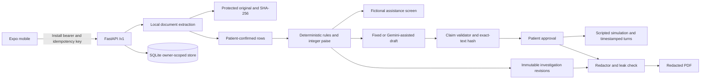

# FairBill backend

FairBill investigates synthetic hospital bills. The Expo app uses the FastAPI V1 contract and retains compatibility with the original local demo. Every quote, review question and monetary impact is traceable to an observed document line or a fictional rule or policy citation.

## Responsibilities

- PyMuPDF reads native PDF text. Tesseract reads scanned pages and photos locally. V1 preserves extracted text, line positions and OCR confidence when the extractor provides them. The patient confirms the source observations before the rules run.
- Deterministic rules propose billing questions in integer paise. Unresolved insurance deductions stay separate from invoice adjustments. All reference tariffs, quantity limits and assistance clauses are labeled fictional. A policy citation still needs applicability review.
- Optional Gemini can order the local investigation and select wording for eligible bundled cases. The claim validator checks the resulting letter against confirmed facts. The template supports the full workflow offline.
- SHA-256 binds approval to the exact draft and case revision. Wording edits clear the approval. The call state machine records the patient and system turns first, then permits the advocate to speak after verification. The letter and call receipts are simulated. The packet redactor validates the exported text and PDF before either representation is returned.

## Contract and persistence

- V1 routes are served under `/v1`. The [OpenAPI contract](openapi.json) is generated with `./scripts/export-openapi.sh` after installing the server dependencies.
- Mutations carry the current case revision. Supply `Idempotency-Key` for replay protection. The same key and payload replay the original successful response for up to 24 hours. Reusing a key with another request returns a conflict. SQLite serial checks prevent concurrent lost updates.
- A deliberate investigation run creates a new revision. Changes to confirmed evidence invalidate the current approval. V1 records the state at every write in an append-only snapshot table. Revisions and diffs read the stored findings and scenario for each run.
- The install token scopes cases to their owner. SQLite lives under `.local/` by default. Original files are stored beside the database with restricted file permissions and their SHA-256 recorded in the document. The API does not offer a raw original file download route.
- V1 errors use `code`, `message`, and `details`. Health also reports `profile`, `mode`, OCR availability and database status. Request logs contain the route template, status, duration and request ID.

## Operating profiles

| | Local demo | Hosted closed-test demo |
|---|---|---|
| Configuration | `FAIRBILL_PROFILE=local` | `FAIRBILL_PROFILE=fixtures` |
| Transport | Loopback by default. Use USB forwarding for an Android phone. | Approved HTTPS origin in front of one FastAPI instance |
| Inputs | Synthetic photo, PDF, paste and bundled fixtures | Bundled fixtures and fictional assistance examples |
| Access | Per-install bearer | Per-install bearer plus a tester-supplied invite |
| Model | Offline by default, optional Gemini | Offline |

Use a separate persistent volume for the hosted SQLite store. Configure `FAIRBILL_INVITE_CODE` on the server and distribute test invites through the tester onboarding process. Apply request rate and upload limits at the HTTPS ingress as well. In the hosted profile, the API blocks legacy routes, document uploads, pasted text and arbitrary text edits. The hosted build runs without a real messaging or calling integration. The in-process rate limit applies per direct client address.

The initial closed test fits one instance with SQLite. A multi-instance deployment calls for managed PostgreSQL, private document storage and an access model with approved retention controls. Supabase is one option for that architecture.
